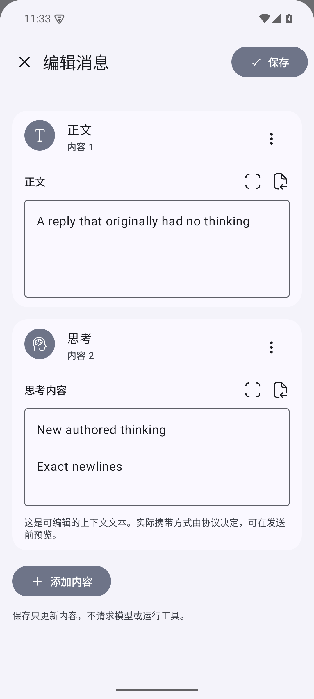
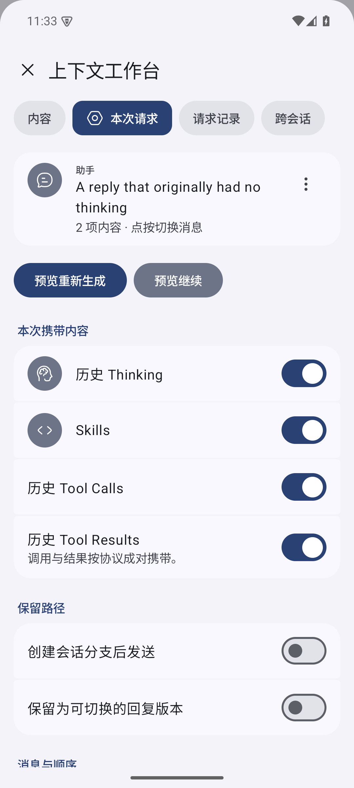
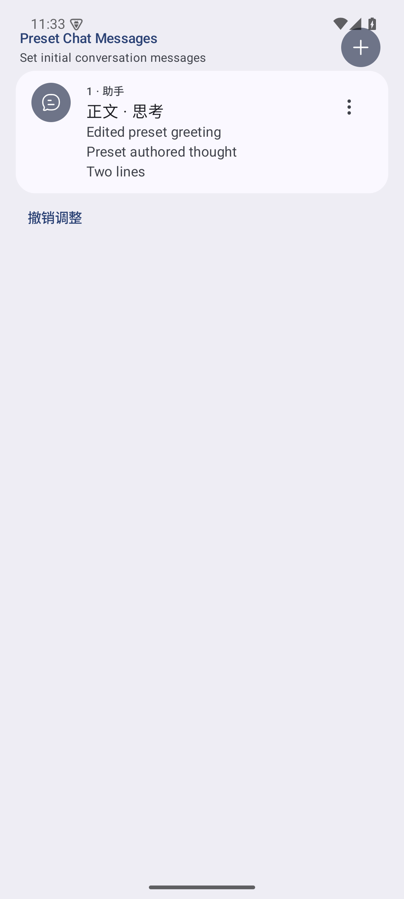

<div align="center">
  
  <h1>RikkaHub Context Engineering</h1>
  <p><strong>上下文完全由你掌控，下一步由你决定。</strong></p>
  <p>原生 Android 上下文工程工作台</p>
  <p><a href="https://github.com/LiweiDonVee/rikkahub-context/releases/tag/v3.1.2-context.2">下载 APK</a> · <a href="docs/context-engineering/user-guide.zh-CN.md">使用指南</a> · <a href="README_EN.md">English</a> · <a href="README_ZH_TW.md">繁體中文</a></p>
</div>

基于 [RikkaHub](https://github.com/rikkahub/rikkahub) 的独立 Fork，让你自主组织模型看到的内容，并直接干预交互过程。

消息、Thinking、工具调用、工具结果和助手预填充都可以编辑。你可以跨会话组合信息，选择本次携带的历史、Skills 和工具记录，检查并修改真实请求正文，再决定发送、运行工具或从某个位置继续。

**编辑、选择、执行和继续，各自独立，由你调度。** 直接修改是默认路径，回复版本和会话分支随时可用。

## 你可以怎样使用

| 想做什么 | 在客户端里完成 |
|---|---|
| 给已有回复补充思考 | 添加第一段 Thinking，修改全文，调整部件顺序，再选择是否携带 |
| 设计助手的初始上下文 | 在原有「预设聊天消息」中组合用户消息、助手正文和 Thinking |
| 精确选择下一次请求 | 选择消息和顺序，控制历史 Thinking、Skills、工具调用与结果 |
| 改写工具交互 | 编辑名称、参数和结果；单独重跑一个工具，或从保存的结果继续 |
| 自由组合不同会话 | 非连续选择消息，指定目标与位置，原样复制、转文字或合并 |
| 比较上下文实验 | 查看实际请求、JSON 路径差异，以及每轮归档回复 |

## 原生界面，直接编辑

历史消息、插入消息和助手预填充共用完整内容编辑器。添加、删除、排序、撤销和全文编辑在同一处完成，修改正文会保留其他部件。

<table>
  <tr><th>完整内容编辑</th><th>本次请求</th><th>助手预填充</th></tr>
  <tr>
    <td></td>
    <td></td>
    <td></td>
  </tr>
</table>

## 从编辑到模型请求

1. 打开消息「更多 → 上下文工作台 / Inspector」，或直接选择「编辑」。
2. 添加和改写内容，保存历史。
3. 在「本次请求」选择消息、顺序及携带内容，点击「预览重新生成」或「预览继续」。
4. 检查实际 Provider 序列化正文，按需修改消息、系统指令和参数，确认发送。
5. 在「请求记录」查看来源、排除项、正文及归档回复，比较下一次实验。

输入框的「保存并预览」也能直接进入这条流程。工具的「重新执行工具」和「从结果继续」分别控制执行与生成。

## 安装

当前版本：**3.1.2-context.2**。支持 Android 8.0 / API 26 及以上。

- [ARM64 APK](https://github.com/LiweiDonVee/rikkahub-context/releases/download/v3.1.2-context.2/RikkaHub-Context-3.1.2-context.2-arm64-v8a-debug.apk)：普通 ARM64 手机。
- [通用 APK](https://github.com/LiweiDonVee/rikkahub-context/releases/download/v3.1.2-context.2/RikkaHub-Context-3.1.2-context.2-universal-debug.apk)：包含 ARM64 和 x86_64。
- [版本与更新记录](https://github.com/LiweiDonVee/rikkahub-context/releases) · [校验文件](https://github.com/LiweiDonVee/rikkahub-context/releases/download/v3.1.2-context.2/SHA256SUMS.txt)

本次分发使用 Debug 签名。应用包名为 `me.rerere.rikkahub.context.debug`，可与官方 RikkaHub 并存。安装后在原有设置中配置自己的 Provider、端点和模型；模型、API 和上下文组织方式由你选择。

## 保留 RikkaHub 的完整底座

保留原生 Material 3 Expressive 界面、多 Provider、MCP、Skills、工作区、多模态、Markdown、搜索、记忆和角色卡导入，并扩展原有消息、预填充和会话分支机制。

Thinking 是客户端可访问或由你编写的思考文本。不同协议使用自己的字段；预览会显示实际表示，并说明确定省略的内容。签名对象可保留、排除或显式转为正文，详见 [Provider 说明](docs/context-engineering/provider-compatibility.md)。

## 文档与开发

- [使用指南](docs/context-engineering/user-guide.zh-CN.md)：七条完整操作流程与原生预填充。
- [构建指南](docs/context-engineering/build.md)：环境、构建、测试和签名。
- [架构](docs/context-engineering/architecture.md)：历史、上下文编译、真实请求和回复归档。
- [验证记录](docs/context-engineering/testing.md)：**833 项 JVM 测试、16 项 Android 集成/UI 测试通过**。
- [上游同步](docs/context-engineering/upstream-maintenance.md) · [更新记录](CHANGELOG.md) · [参与贡献](CONTRIBUTING.md)

```sh
git clone https://github.com/LiweiDonVee/rikkahub-context.git
cd rikkahub-context
pnpm --dir web-ui install --frozen-lockfile
./gradlew assembleGithubDebug
```

## 上游与许可证

本项目基于 [rikkahub/rikkahub](https://github.com/rikkahub/rikkahub)，从 `9bc0fd65` 接入 Fork 改造。感谢原作者及所有贡献者提供原生客户端、Provider 适配与工具生态。

沿用 [GNU AGPL-3.0](LICENSE)，保留上游和第三方归属。这个 Fork 的反馈与改进请提交到 [本仓库 Issues](https://github.com/LiweiDonVee/rikkahub-context/issues) 或 Pull Requests。
