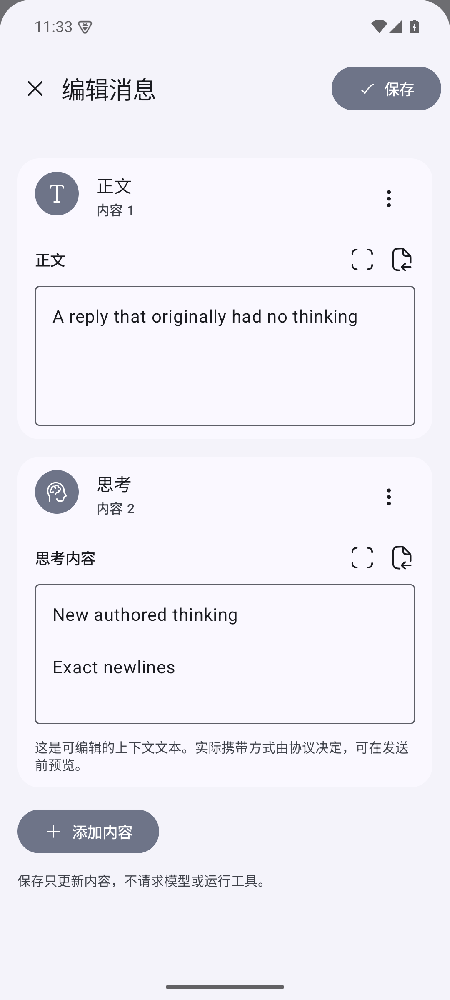
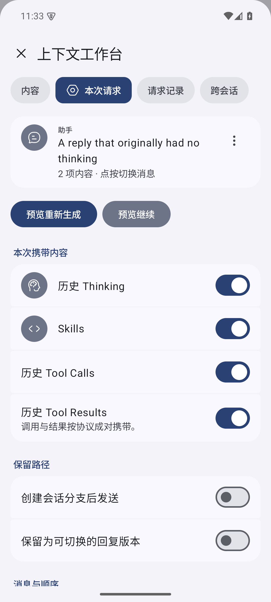
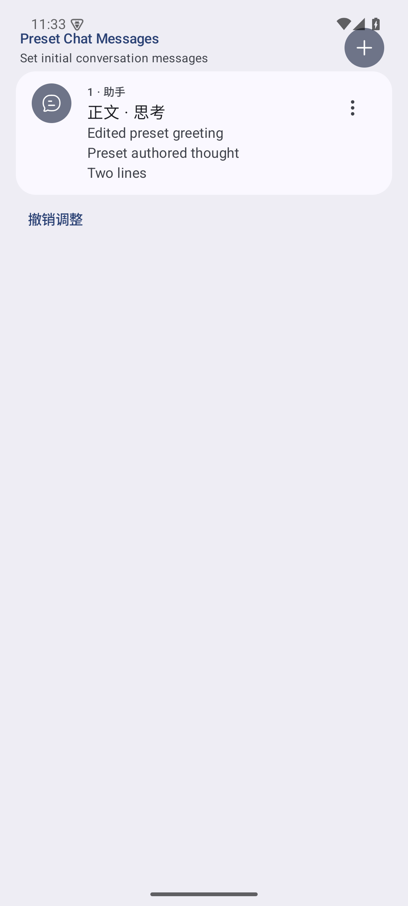

<div align="center">
  
  <h1>RikkaHub Context Engineering</h1>
  <p><strong>Your context. Your decisions.</strong></p>
  <p>A native Android workspace for user-directed context engineering.</p>
  <p><a href="https://github.com/LiweiDonVee/rikkahub-context/releases/tag/v3.1.2-context.4">Download APK</a> · <a href="README.md">简体中文</a> · <a href="README_ZH_TW.md">繁體中文</a></p>
</div>

An independent fork of [RikkaHub](https://github.com/rikkahub/rikkahub) that puts context composition in your hands.

Edit messages, accessible reasoning, tool calls, tool results, and assistant presets. Assemble context across conversations, choose what to include, and inspect or modify the actual serialized request before sending it. You decide where to continue and when to run a tool.

**Editing, selection, execution, and continuation are separate actions under your control.** Edit the current history directly, keep an alternative reply, or create a conversation branch.

Edited Thinking is sent through the current provider with its metadata preserved. Successful replies render normally; failures report the endpoint’s actual error.

## What you can do

| Workflow | In the app |
|---|---|
| Add reasoning to a reply | Create its first Thinking part, edit the full text, reorder parts, and choose whether to send it |
| Build an assistant's starting context | Compose user and assistant messages, text and Thinking in the existing preset editor |
| Select a precise request | Choose messages, order, historical Thinking, Skills, calls and results |
| Rewrite tool interactions | Edit names, JSON arguments and results; rerun one tool or continue from a saved result |
| Combine conversations | Filter by assistant, search and sort conversations, select messages, and create or import context at any position |
| Compare experiments | Inspect wire bodies, JSON-path differences and each run's archived reply |

## Native editing

One full-content editor serves chat history, inserted messages, and assistant presets. Add, remove, reorder and undo within one draft, then save. Editing ordinary text preserves the other parts.

<table>
  <tr><th>Full-content editor</th><th>Request selection</th><th>Assistant presets</th></tr>
  <tr>
    <td></td>
    <td></td>
    <td></td>
  </tr>
</table>

## Edit, preview, send

1. Open a message's Context Workbench / Inspector, or choose Edit.
2. Add or change its parts and save the history.
3. Select the context and order in the request tab, then preview regeneration or continuation.
4. Inspect the production provider's serialized body. Edit messages, system instructions or parameters and confirm sending.
5. Inspect request records, sources, omissions and archived replies; compare another run.

The input's Save and Preview action enters the same pipeline. Run Tool and Continue from Result independently control tool execution and model generation.

## Install

Current version: **3.1.2-context.4**. Android 8.0 / API 26 or later.

- [ARM64 APK](https://github.com/LiweiDonVee/rikkahub-context/releases/download/v3.1.2-context.4/RikkaHub-Context-3.1.2-context.4-arm64-v8a-debug.apk).
- [Universal APK](https://github.com/LiweiDonVee/rikkahub-context/releases/download/v3.1.2-context.4/RikkaHub-Context-3.1.2-context.4-universal-debug.apk), with ARM64 and x86_64.
- [Releases](https://github.com/LiweiDonVee/rikkahub-context/releases) · [SHA-256 checksums](https://github.com/LiweiDonVee/rikkahub-context/releases/download/v3.1.2-context.4/SHA256SUMS.txt).

The current APKs use Debug signing and package `me.rerere.rikkahub.context.debug`, so they can coexist with official RikkaHub. Configure your own provider, endpoint and model in the existing settings.

## The RikkaHub foundation

The fork retains Material 3 Expressive, multiple providers, MCP, Skills, workspaces, multimodal messages, Markdown, search, memory and character-card imports. It extends the existing message, preset and branch systems.

Thinking here means accessible or user-authored reasoning text. Each protocol has its own representation. Edited reasoning can be sent with its existing signatures and encrypted metadata; the preview shows the actual body. The endpoint decides what it accepts. See [provider notes](docs/context-engineering/provider-compatibility.md).

## Develop

```sh
git clone https://github.com/LiweiDonVee/rikkahub-context.git
cd rikkahub-context
pnpm --dir web-ui install --frozen-lockfile
./gradlew assembleGithubDebug
```

[Build guide](docs/context-engineering/build.md) · [Architecture](docs/context-engineering/architecture.md) · [Verification](docs/context-engineering/testing.md) · [Upstream maintenance](docs/context-engineering/upstream-maintenance.md) · [Contributing](CONTRIBUTING.md)

The context.4 validation includes **841 JVM tests and 23 Android integration/UI tests passing**.

## Upstream and license

Based on [rikkahub/rikkahub](https://github.com/rikkahub/rikkahub) at `9bc0fd65`. Thanks to the upstream authors and contributors for the native client, provider adapters and tools.

Licensed under [GNU AGPL-3.0](LICENSE), retaining upstream and third-party notices. Please use [this fork's issues](https://github.com/LiweiDonVee/rikkahub-context/issues) and pull requests for fork feedback.
