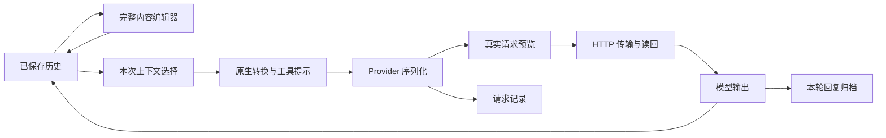

# 架构

基于上游 `9bc0fd65873c77b42e2743c9c7dba4d4594a6478`，在原有消息、会话、Provider 和 Compose 界面上扩展上下文控制。

## 数据流

编辑改变历史，选择构造本次副本，序列化生成实际正文。确认之后使用相同字节发送，三者分别保存。

## 主要结构

| 结构 | 职责 |
|---|---|
| `UIMessage.parts` | 有序的正文、Thinking、附件、工具调用与结果 |
| `ContextMessageState` | 首份原件、排除项、来源、工具执行记录及旧版本编辑标记 |
| `ContextPartDraft` | 部件的原始索引和稳定 UI key，保证增删重排后状态映射正确 |
| `ContextSelection` / `CompiledContext` | 本次消息、顺序及内容选择，以及可追踪的排除原因 |
| `RequestControl` / `RequestReviewGate` | 最终正文的确认、取消和实际传输读回 |
| `ContextRequestEntity` | 模型、协议、run、回复关联、正文哈希与传输/生成状态 |
| `ContextRequestBodyEntity` | 64 KiB 分块存储请求正文 |
| `ContextResponseBodyEntity` | 每轮保存一份最终/中断回复及本地附件引用 |

Room schema 为 33，从上游 32 自动迁移。消息 JSON 采用默认扩展字段，旧消息继续可读。

## 会话修改

`ConversationSession` 是加载中会话的唯一状态源。ChatService 通过 session 更新并 flush；编辑、恢复、插入、复制和版本选择使用这一条保存路径。

`MessagePartsEditor` 服务普通历史编辑、工作台、插入消息和助手预填充。草稿一次保存，Text 以 copy 更新，原生 metadata 保留；显式转正文承担结构转换。思考文本修改由共享保存路径标记；旧版本编辑标记在请求投影中兼容读取，保留 metadata 并使用当前文本。

## 预填充兼容

继续使用 `Assistant.presetMessages → newConversation → updateCurrentMessages`。模板是初始历史，保留角色、顺序、ID、时间和未编辑 metadata。保存模板只更新 preset 列表；已有会话和分支使用自己的历史。

本地模板附件在初始化时为各会话分别复制；内容、恢复部件和工具记录共享同次复制映射。模板作者的编辑过程不新增为新聊天的恢复基线。

## Provider 集成

`ChatRequestFactory` 在原有上下文条数与压缩检查点后编译请求副本，再经过系统提示、记忆、工具提示和输入转换。

五个 Provider 边界在最终原生正文及自定义 JSON 合并后调用 `prepareRequest`。确认后的字符串直接作为 HTTP 正文，拦截器读回并校验。签名、密文、模型和工具定义编辑按正文发送；HTTP 错误保留状态码和原始返回正文。认证使用现有网络配置，HTTP 认证头不写入快照。

OCR 使用相同边界。需要远端 OCR 时先确认附件请求，随后展示聊天请求；取消关联到底层 Call。用户改写过的 OCR 请求不写入普通附件缓存。

## 执行与断点

上下文请求使用新的 Agent 输出槽，历史未完成调用只作为上下文数据处理。新客户端工具调用保持手动审批；独立 Run 校验当前授权及 JSON，只执行所选工具。Continue 使用保存的结果发起新的模型交互。

连续并行调用按组构建。调用和结果成对保留或排除，部分完成状态按具体工具记录。再生成可替换当前回复、保留节点候选，或进入会话 Fork。

## 归档与文件

序列化调用对应请求记录，run 对应一次生成。结束、失败或取消时，保存该轮实际产生并写入的回复；多次物理请求共享本轮归档。后续编辑保持旧归档。

大正文按块存储并按需读取。归档附件参与引用检查，会话删除级联清理请求/回复记录及其文件。跨会话和分支复制建立独立附件所有权。

## 代码入口

- `ai/src/main/java/me/rerere/ai/context/`：草稿、选择、编译、工具参数校验和推理携带反馈。
- `ai/src/main/java/me/rerere/ai/provider/RequestControl.kt`：最终正文、编辑校验、遮蔽和差异。
- `app/src/main/java/me/rerere/rikkahub/data/ai/ChatRequestFactory.kt`：真实组装路径。
- `app/src/main/java/me/rerere/rikkahub/data/ai/ContextRequestStore.kt`：预览 gate、记录和网络读回。
- `app/src/main/java/me/rerere/rikkahub/service/ChatService.kt`：保存、工具、断点与会话操作。
- `app/src/main/java/me/rerere/rikkahub/ui/components/context/`：原生工作台和共享编辑器。
- `app/src/main/java/me/rerere/rikkahub/ui/pages/assistant/detail/AssistantPresetMessages.kt`：原生预填充入口。
