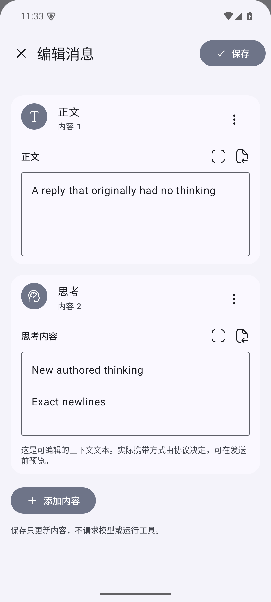
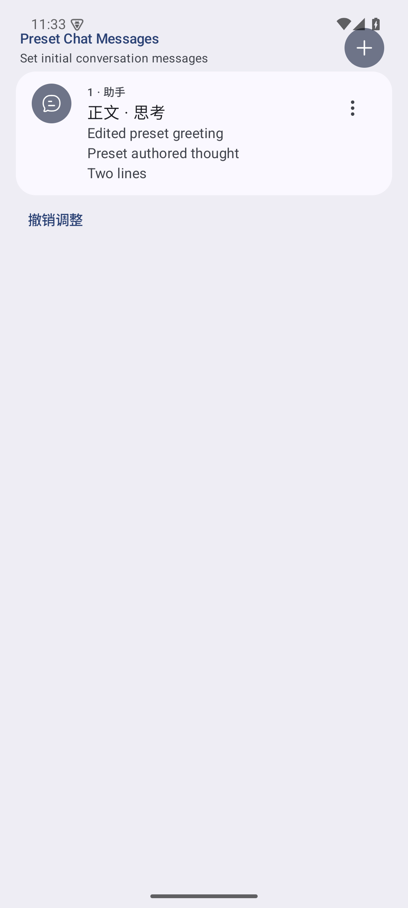
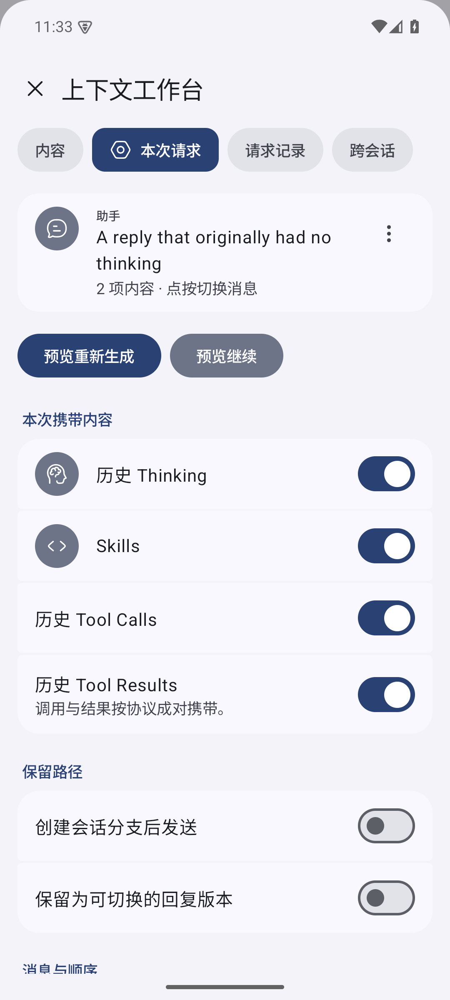

# 使用指南

RikkaHub Context Engineering 让你直接组织下一次模型交互。历史可以编辑，请求可以选择，工具可以单独运行；你决定每一步从哪里开始。

## 开始使用

1. 从[本项目 Releases](https://github.com/LiweiDonVee/rikkahub-context/releases) 安装 APK。
2. 在原有设置中添加 Provider、API 端点、凭证和模型，并为助手选择模型。
3. 打开聊天。消息「更多 → 上下文工作台 / Inspector」提供细粒度操作，普通「编辑」打开完整内容编辑器。

工作台分为「内容」「本次请求」「请求记录」「跨会话」。

## 1. 编辑一条消息，包括它原来没有的思考

打开「编辑完整内容」，或在内容页点击 +。添加正文、思考、工具调用或附件。

每段内容都可以全文编辑。省略菜单提供上移、下移、转为正文和删除；「撤销调整」恢复最近一次结构调整。改好后一次保存，消息身份、角色和未编辑的部件继续保留。

可以只保留 Thinking，也可以把全部部件删成空消息。历史的「恢复原始内容」可恢复首次修改前的内容。

保存只更新内容。需要生成时，再使用「预览重新生成」或「预览继续」。修改历史中间位置后，后续回复仍保留；需要独立后续路径时创建会话分支。

## 2. 设计助手的初始上下文

打开「助手 → 提示词 → 预设聊天消息」。这里沿用 RikkaHub 原有的预填充设置。

点按一条预填充消息，进入同一个完整编辑器。你可以给纯文本助手消息添加第一段 Thinking，保留正文，也可以调整部件顺序。之后再改正文，思考及其他部件仍会保留。

列表中的省略菜单调整整条消息的顺序。角色选择沿用用户与助手；消息内部的部件顺序单独管理。

保存后的预设用于之后创建的新会话。已有会话继续保留自己的历史，分支复制当前路径。原有消息 ID、时间、角色和未编辑 metadata 保留，角色卡导入的首句按字面内容处理。本地附件在新会话中有独立文件，方便分别删除和继续实验。

## 3. 只携带这次需要的内容

在「本次请求」选择：

- 要包含的消息及顺序。
- 历史 Thinking。
- Skills。
- 工具调用和工具结果。
- 直接生成、保留回复版本或创建会话分支。

这些选择作用于本次请求。原有上下文条数和压缩检查点继续参与构建，排除原因写入请求记录。

工具调用和结果按协议配对。并行调用一起继续；缺失结果可以先执行，或明确排除相应调用。

点击「预览重新生成」或「预览继续」检查结果。输入框的「保存并预览」会先保存用户消息，再打开相同的真实构建流程；取消后这条消息留在历史中。

## 4. 修改一个工具，决定运行还是继续

在完整编辑器里选择当前已授权工具，编辑完整参数 JSON。普通文字结果直接全文编辑，复杂结果保留内容部件 JSON。

保存后，有三条独立路径：

| 操作 | 结果 |
|---|---|
| 重新执行工具 | 使用保存的参数真实运行所选工具，保留旧结果及新执行记录 |
| 从这里重新生成 | 用断点前的上下文重新请求模型 |
| 从结果继续 | 用保存的工具结果继续生成 |

例如，将某次计算的参数改为 `40 + 1`，单独运行得到 `41`，再预览继续，让模型使用新结果。也可以直接改写结果并继续上下文实验。

工作台产生的新客户端工具调用使用手动执行；审批只运行所选工具，运行后再选择继续。普通聊天沿用原有工具行为。

## 5. 自由组合不同会话

在「跨会话」选择连续或非连续消息，指定目标会话和插入位置，再选择：

- 原样复制：保留角色及部件结构。
- 转普通文本：按消息逐条转换。
- 合并：放进一条用户消息。

来源会话保持原样。目标使用新的消息与调用身份，本地附件独立复制，来源仍可追踪。原样复制支持跨 Provider；也可以主动选择文本方式。

所选消息的省略菜单还可在前后插入新消息，使用完整编辑器创建正文、Thinking 和工具内容。

## 6. 检查并修改真实请求

预览来自生产 Provider 的最终序列化正文，包括输入转换和自定义请求体合并后的结果。

「编辑正文」修改实际 JSON；「结构视图」展开字段。可以调整消息、系统指令、模型名、生成参数、工具定义和原生内容块。流式模式通过会话设置切换，使响应解码器与请求一致。

确认后直接发送当前正文。需要外部 OCR 的附件会先展示 OCR 请求，确认后再生成聊天请求预览。

Thinking 指可访问或由你编写的思考文本。不同协议使用自己的字段；修改后保留原始 metadata 并发送当前文本。接口成功返回就正常渲染，HTTP 失败显示实际状态码和返回正文。排除或转为正文也由你选择。[Provider 说明](provider-compatibility.md)列出具体表示。

## 7. 比较两次上下文实验

在「请求记录」选择一次请求，检查模型、协议、正文、来源和排除项。可以只看当前回复的请求，或展开会话全部记录。

选择另一次请求，按 JSON 路径比较消息、工具、结果和参数，再比较各轮归档回复。归档保存的是该轮结束时保留的回复或中断片段；之后编辑或直接再生成会保留旧归档。

`prepared` 表示已准备，`dispatch_started` 表示进入传输，`response_headers_received` 表示收到响应头。升级前没有记录的请求显示未知。

请求记录保存在本机。认证头不进入快照，已识别的 JSON 认证字段会遮蔽；普通对话内容仍按本地聊天数据保存。

## 分支与恢复

最后一条助手回复默认可以直接重新生成。需要保留两种回答时选择回复版本；需要独立发展路径时创建会话分支，使用原有会话列表切换并继续。

结合首份原件、可切换回复和独立会话，你可以从轻量修改开始，再为值得保留的实验建立路径。
